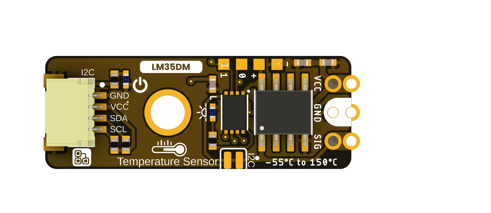

# DevLab I2C LM35 Temperature Sensor

**MPN: UE0169**

The DevLab I2C LM35 Temperature Sensor is an I2C temperature sensing module in the UNIT Electronics DevLab family.

  
  
<em>DevLab I2C LM35 Temperature Sensor</em>

### Quick Setup

## Overview

| Feature | Description |
|---|---|
| Product | DevLab I2C LM35 Temperature Sensor |
| MPN | UE0169 |
| Interface | I2C |
| Available visuals | Product-specific top and bottom board views |
| Factory I2C Address | `0x33` (7-bit) |
| DDP Device ID | `0x0113` |
| Firmware Status | Stable |
| Firmware .bin Date | 2026-10-21 10:58 CST |

## Applications

- Temperature monitoring with an I2C host.
- Environmental data logging prototypes.
- LM35 sensor integration experiments.

## Resources

- [Hardware files and board views](hardware/README.md)
- [Product reference source](tools/product-reference/README.md)
- [Generic I2C scanner examples](software/README.md)
- [Controller firmware repository](https://github.com/UNIT-Electronics-Labs/unit_firmware_i2c_lm35_module)
- [Arduino support library](https://github.com/UNIT-Electronics-MX/unit_devlab_lm35_library)

The supplied source package does not include a product-specific schematic. Check the product-specific pinout or schematic for wiring and electrical limits.

## 📝 License

All hardware and documentation in this project are licensed under the **MIT License**.
See the [repository license](LICENSE) for details.

  Template created by UNIT Electronics

