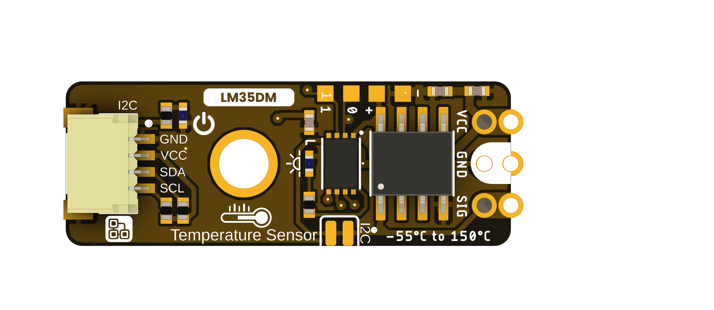
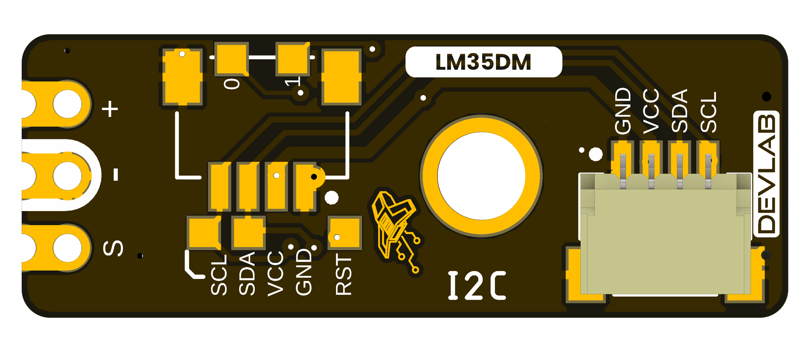

# DevLab I2C LM35 Temperature Sensor

MPN: **UE0169**

## Board Views

## Mechanical Drawings

- [Board dimensions](resources/unit_dimensions_v_1_1_ue0169_devlab_i2c_lm35_temperature_sensor.png)
- [Board topology](resources/unit_topology_v_1_1_ue0169_devlab_i2c_lm35_temperature_sensor.png)

## Pinout

A product-specific pinout drawing was not included in the selected source package.

Board renders show the supplied layout. Confirm electrical limits, connector
orientation, and mechanical tolerances against product-specific drawings before
using the board in a final assembly.
