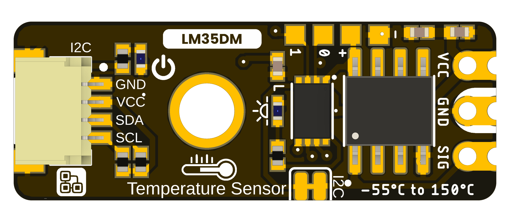
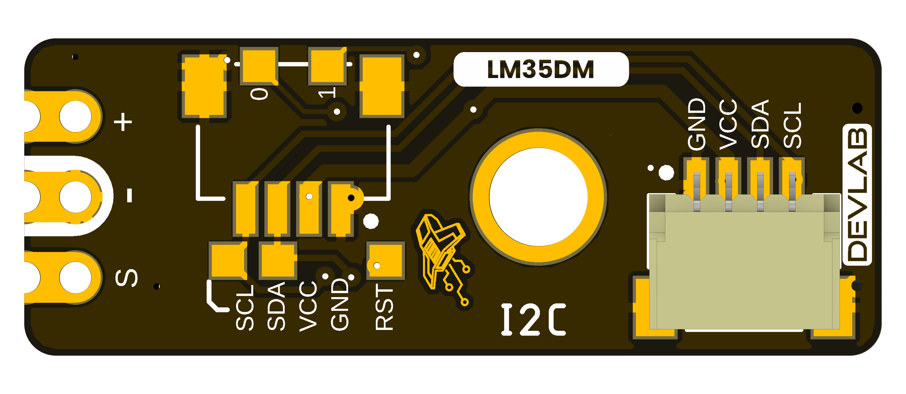

# DevLab I2C LM35 Temperature Sensor Hardware

## Hardware Scope

This page records the available hardware files for **DevLab I2C LM35 Temperature Sensor**. Values not supported by a product-specific drawing or schematic remain unspecified.

| Field | Value |
|---|---|
| MPN | UE0169 |

## Power Tree

A dedicated board-level power-tree drawing is not included in the available product-specific files.

## Block Diagram

A dedicated functional block diagram is not included in the available product-specific files.

## Naming Rules

- Product name: **DevLab I2C LM35 Temperature Sensor**.
- Product family: **UNIT DevLab ecosystem**.
- Existing source filenames retain their published names and revisions.
- Generated Product Reference: `unit_product_reference_v_1_1_0_ue0169_devlab_i2c_lm35_temperature_sensor.pdf`.

## Hardware

### Schematic

[UE0169 Rev 1.0.0 schematic](unit_sch_v_1_0_0_ue0169_devlab_i2c_lm35_temperature_sensor.pdf)

## Pinout

- [English pinout](./unit_pinout_v_1_1_ue0169_devlab_i2c_lm35_temperature_sensor_en.pdf)
- [Spanish pinout](./unit_pinout_v_1_1_ue0169_devlab_i2c_lm35_temperature_sensor_es.pdf)

## Dimensions

- [Board dimensions preview](resources/unit_dimensions_v_1_1_ue0169_devlab_i2c_lm35_temperature_sensor.png)
- [Board dimensions PDF](unit_dimensions_v_1_1_ue0169_devlab_i2c_lm35_temperature_sensor.pdf)

## Topology

- [Board topology](resources/unit_topology_v_1_1_ue0169_devlab_i2c_lm35_temperature_sensor.png)
- [STEP model](./mechanics/unit_3d_v_1_1_ue0169_devlab_i2c_lm35_temperature_sensor.step)

## Pin & Connector Layout

A verified product-specific connector map is not included in the available source package. Do not infer electrical pin assignments from the board renders.

## Functional Description

The DevLab I2C LM35 Temperature Sensor is an I2C temperature sensing module in the UNIT Electronics DevLab family.

## Applications

- Temperature monitoring with an I2C host.
- Environmental data logging prototypes.
- LM35 sensor integration experiments.

## References

- [Product Reference](../docs/hardware/unit_product_reference_v_1_1_0_ue0169_devlab_i2c_lm35_temperature_sensor.pdf)
- [Product Reference source](../tools/product-reference/README.md)
- [Electrical schematic](unit_sch_v_1_0_0_ue0169_devlab_i2c_lm35_temperature_sensor.pdf)
